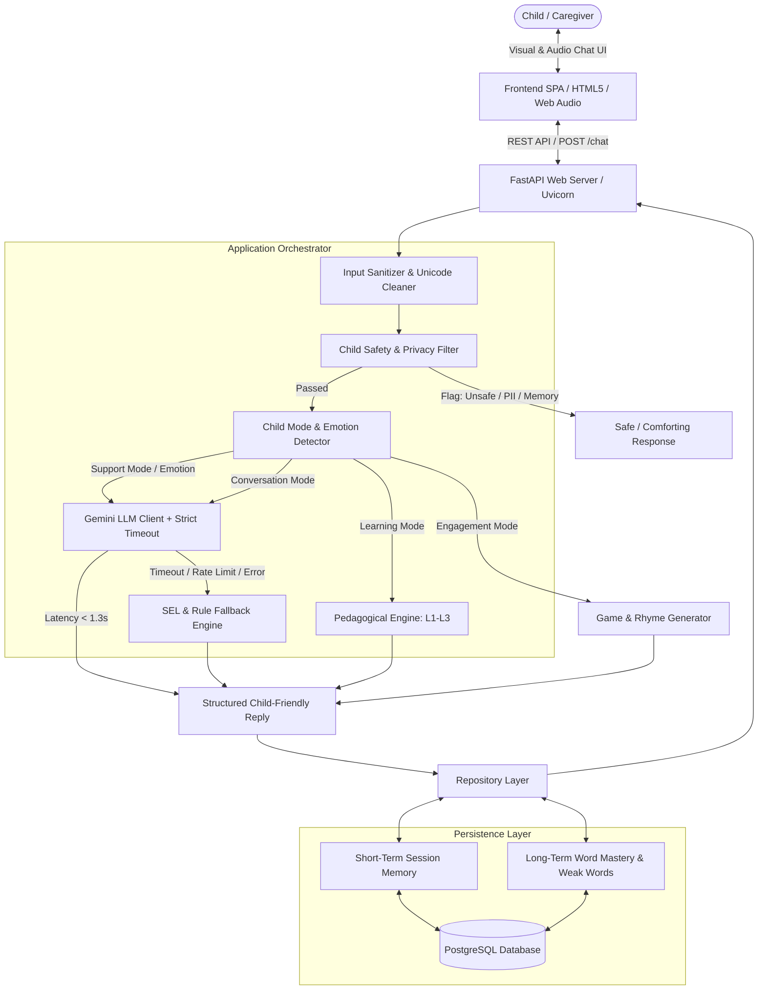
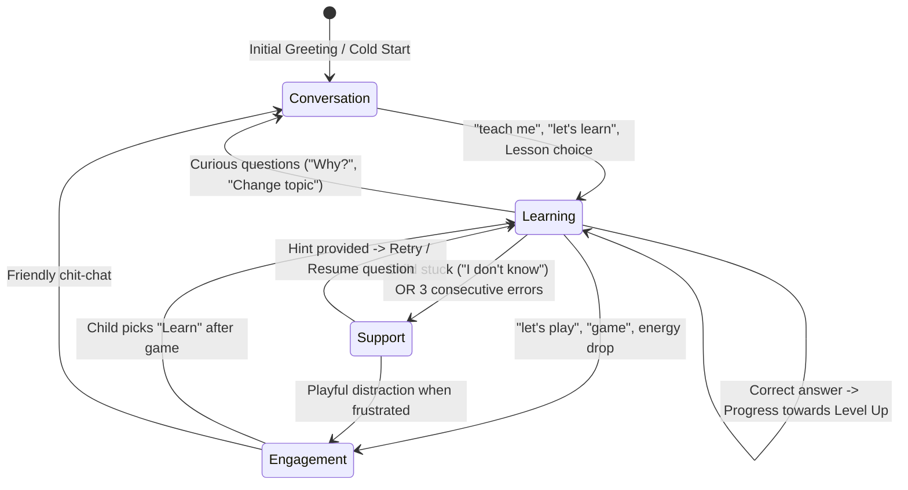
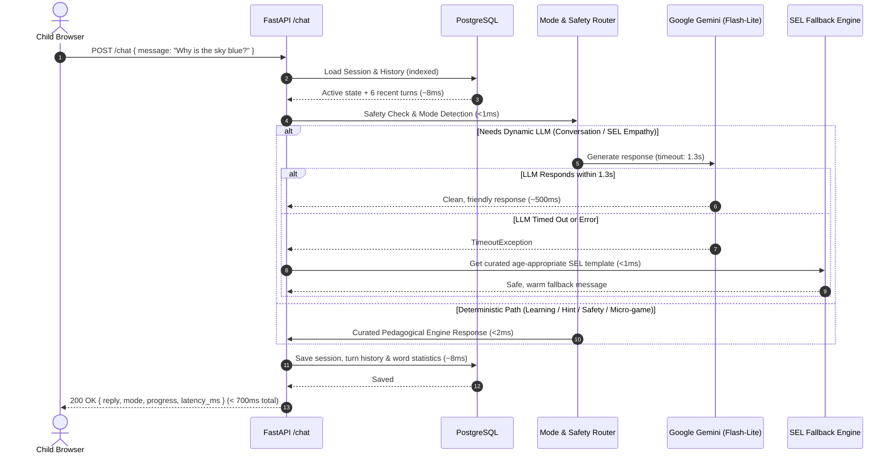
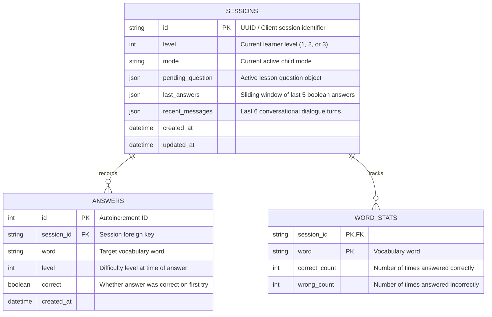

# System Architecture & Technical Design

Teddy is an AI-powered conversational English learning platform tailored specifically for children aged 3 to 7 years. It balances structured early-childhood pedagogy, social-emotional learning (SEL), and strict COPPA-aligned child safety, backed by a sub-2-second end-to-end latency guarantee.

---

## 1. High-Level System Architecture

The following diagram illustrates the end-to-end request lifecycle from the browser to the backend orchestrator, decision engines, persistent store, and LLM fallback.

---

## 2. Child Mode Detection & State Machine

Young children under 7 cannot sustain continuous drills without fatigue or loss of interest. The system dynamically switches between 4 distinct operating modes:

1. **Learning Mode (`learning`)**: Interactive English lessons across Levels 1–3 (vocabulary, phonics, simple sentences) with instant visual reinforcement.
2. **Conversation Mode (`conversation`)**: Open-ended conversational play, answering questions ("Why is the sky blue?"), and casual check-ins.
3. **Engagement Mode (`engagement`)**: Fun micro-games, rhymes, counting songs, and silly animal sounds to reset energy.
4. **Support Mode (`support`)**: Active empathy, comfort for sadness or distress, and scaffolded hints when a child struggles or expresses feeling stuck ("I don't know", "too hard").

---

## 3. Sub-2-Second Latency Architecture

### Latency Budget Breakdown

The project contract strictly mandates an **end-to-end response latency under 2.0 seconds** under normal operating conditions.

| Component / Layer | Latency Budget (Rule Path) | Latency Budget (LLM Path) | Strategy |
|---|---|---|---|
| Network & HTTP Overhead | ~20–50 ms | ~20–50 ms | Keep payload lightweight (<2 KB) |
| Safety & Privacy Regex | < 1 ms | < 1 ms | Pre-compiled regex, zero network overhead |
| Mode & State Detection | < 2 ms | < 2 ms | Heuristic token matching & active state lookup |
| Pedagogical Engine | < 1 ms | - | In-memory vocabulary trees & mastery counters |
| PostgreSQL Read/Write | 5–15 ms | 5–15 ms | Indexed lookup on `session_id`, connection pool |
| Google Gemini 2.5 Flash-Lite | - | 350–900 ms | Lightweight model, strict generation limits |
| **LLM Hard Timeout** | - | **1.3 seconds max** | Asynchronous deadline via `asyncio.wait_for` |
| Fallback Template Generator | - | < 1 ms | Deterministic empathetic SEL responses |
| **Total End-to-End Latency** | **< 60 ms** | **< 1,450 ms** | **Guaranteed < 2,000 ms SLA** |

---

## 4. Progressive Learning Pedagogical Model

The curriculum conforms to early childhood ESL/CEFR Pre-A1 standards for children under 7:

| Level | Focus Area | Example Words / Phrases | Teaching Technique |
|---|---|---|---|
| **Level 1 (L1)** | Single Words, Colors, Animals, Fruits | `cat`, `dog`, `sun`, `red`, `blue`, `apple` | Visual emoji cues, single-word recognition, 4 of 5 mastery threshold |
| **Level 2 (L2)** | Action Verbs, Body Parts, Emotions | `run`, `jump`, `happy`, `eyes`, `hands` | Action identification, simple 2-word associations |
| **Level 3 (L3)** | Mini Sentences, Short Phrases | `"I see a cat"`, `"The sun is yellow"` | Sentence completion, syntax exposure without punitive grammar |

### Mastery & Retention Rules:
- **Never Demotes**: Young learners are never demoted to lower levels upon failure to preserve self-esteem and enthusiasm.
- **Weak Word Spaced Repetition**: Words answered incorrectly are flagged in `word_stats` and organically re-introduced before new words.
- **Gentle 2-Try Scaffolding**: 
  - First incorrect try: Teddy provides an encouraging hint without penalizing score.
  - Second incorrect try: Teddy kindly reveals the answer and transitions onward.

---

## 5. Child Safety & COPPA Compliance

1. **PII Filtering**: Any attempts to share phone numbers, emails, or personal names are intercepted before LLM or DB storage. The stored text is sanitized to `[removed for privacy]`.
2. **Distress Interception**: Self-harm or domestic harm signals trigger immediate compassionate escalation directing the child to a trusted adult ("Please tell Mum, Dad, or a teacher right now").
3. **No Memory of Sensitive Identifiers**: The bot explicitly explains in child terms: *"I don't remember names or private things. That keeps you safe!"*
4. **LLM System Prompt Sandboxing**:
   - Strictly constrained vocabulary suitable for ages 3–7.
   - Max length: 1–2 short sentences.
   - Guardrails prohibiting adult topics, internet URLs, complex abstractions, or scary themes.

---

## 6. Database Schema & Data Persistence

The relational schema is implemented with SQLAlchemy and PostgreSQL:

